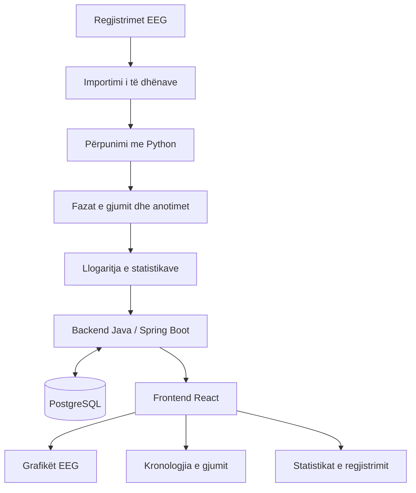
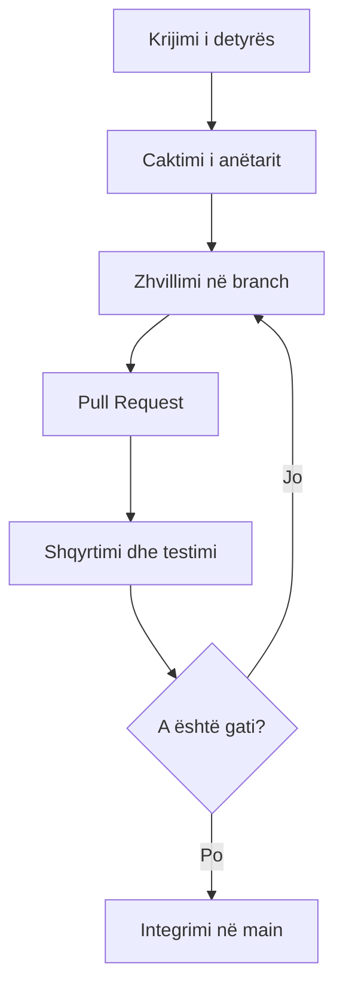

# DREAMSTATE-Inside-the-Sleeping-Brain-Where-Neuroscience-Meets-Software-Engineering
A platform for exploring and visualizing brain activity during sleep using EEG data

**# DREAMSTATE — Inside the Sleeping Brain
### Where Neuroscience Meets Software Engineering

*Çfarë ndodh brenda nesh kur mbyllim sytë dhe bota hesht?*

Gjumi nuk është një gjendje pasiviteti. Ndërsa trupi pushon, truri vazhdon të prodhojë aktivitet elektrik, i cili ndryshon përgjatë fazave të ndryshme të gjumit.

**DREAMSTATE** është një projekt kërkimor dhe edukativ që synon të eksplorojë aktivitetin e trurit gjatë gjumit përmes të dhënave EEG, analizës kompjuterike dhe vizualizimit interaktiv.

Qëllimi ynë është të ndërtojmë një platformë që i shndërron regjistrimet shkencore në informacion të kuptueshëm. Përdoruesit do të mund të eksplorojnë sinjalet EEG, të shohin fazat e gjumit dhe të analizojnë statistika të ndryshme të regjistrimeve.

Projekti nuk synon të lexojë ëndrrat apo të diagnostikojë sëmundje. Ai synon të tregojë se si teknologjia mund të na ndihmojë të eksplorojmë një nga proceset më interesante të trurit njerëzor.

---

## 1. Lidhja mes neurologjisë dhe inxhinierisë së softuerit

DREAMSTATE qëndron në kryqëzimin e dy fushave: **neuroshkencës, e cila studion funksionimin e trurit, dhe inxhinierisë së softuerit, e cila na mundëson të përpunojmë, analizojmë dhe vizualizojmë të dhënat e tij.**

### Neurologjia dhe neuroshkenca

Për të kuptuar aktivitetin e trurit gjatë gjumit, përdoret EEG-ja (*Electroencephalography*), një metodë që regjistron aktivitetin elektrik të trurit përmes elektrodave të vendosura në skalp.

Regjistrimet EEG përmbajnë sinjale që ndryshojnë me kalimin e kohës. Studiuesit mund t'i analizojnë këto sinjale për të studiuar fazat e gjumit, përfshirë zgjimin, fazat NREM dhe gjumin REM.

### Inxhinieria e softuerit

Nga ana tjetër, inxhinieria e softuerit siguron mjetet për ta kthyer këtë informacion në një sistem funksional. Përmes programimit mund të lexojmë skedarët e regjistrimeve, të përpunojmë sinjalet, të ruajmë rezultatet dhe t'i paraqesim ato në një ndërfaqe interaktive.

Në vend që përdoruesi të përballet me skedarë teknikë dhe mijëra vlera numerike, ai do të mund të shohë grafikë, kronologji të fazave të gjumit dhe statistika të përmbledhura.

### Ku takohen të dyja fushat?

Pika e takimit është **përpunimi dhe interpretimi i të dhënave EEG**.

Neuroshkenca na ndihmon të kuptojmë çfarë përfaqësojnë sinjalet dhe fazat e gjumit. Inxhinieria e softuerit ndërton sistemin që i lexon, i organizon, i analizon dhe i paraqet këto të dhëna.

Kështu, projekti lidh një fenomen biologjik real me algoritmet, bazat e të dhënave, analizën e sinjaleve dhe zhvillimin e aplikacioneve.

---

## 2. Objektivat kryesore

- Të eksplorojmë regjistrime EEG të gjumit nga të dhëna kërkimore publike.
- Të lexojmë dhe përpunojmë sinjalet EEG.
- Të vizualizojmë sinjalet në grafikë interaktivë.
- Të paraqesim fazat e gjumit sipas anotimeve të disponueshme.
- Të llogarisim kohëzgjatjen dhe përqindjen e fazave të ndryshme.
- Të ruajmë dhe organizojmë të dhënat në një bazë të dhënash.
- Të zhvillojmë një ndërfaqe të qartë dhe të lehtë për t'u përdorur.
- Si zgjerim i mundshëm, të eksplorojmë klasifikimin automatik të fazave të gjumit përmes Machine Learning.

## 3. Si do të funksionojë sistemi?



Diagrami paraqet rrjedhën e propozuar të të dhënave. Në versionin fillestar mund të përdorim fazat e anotuar paraprakisht në dataset, pa pasur nevojë të trajnojmë një model të inteligjencës artificiale.

## 4. Teknologjitë e propozuara

| Teknologjia | Përdorimi |
|---|---|
| Java | Gjuha kryesore e backend-it |
| Spring Boot | API-të dhe logjika e aplikacionit |
| React | Ndërfaqja e përdoruesit |
| Python | Përpunimi dhe analiza e sinjaleve EEG |
| PostgreSQL | Ruajtja e të dhënave |
| Git dhe GitHub | Versionimi dhe bashkëpunimi |
| JUnit | Testimi i backend-it |
| pytest | Testimi i analizës me Python |
| Postman | Testimi i API-ve |

Teknologjitë përfundimtare do të konfirmohen gjatë fazës së projektimit.

## 5. Burimi i të dhënave

Për analizën e sinjaleve do të shqyrtojmë një dataset publik kërkimor të regjistrimeve të gjumit, si Sleep-EDF Expanded.

Ky dataset përmban regjistrime polisomnografike gjatë gjithë natës, përfshirë EEG dhe anotime të fazave të gjumit. Ai mund të na ndihmojë të ndërtojmë dhe testojmë funksionalitetet kryesore të platformës.

Përpara përdorimit do të shqyrtojmë formatin e skedarëve, strukturën e anotimeve, kushtet e përdorimit dhe madhësinë e të dhënave.

Për prototipin fillestar do të zgjedhim vetëm një numër të vogël regjistrimesh, në mënyrë që të mund të zhvillojmë dhe testojmë sistemin pa përpunuar të gjithë dataset-in.

## 6. Ndarja e përgjegjësive në grup

### Anëtari 1 — Team Leader & Backend
- Organizimi i punës dhe ndjekja e afateve.
- Zhvillimi i backend-it me Java dhe Spring Boot.
- Krijimi i API-ve.
- Koordinimi dhe integrimi i komponentëve.

### Anëtari 2 — Frontend Developer
- Zhvillimi i ndërfaqes me React.
- Ndërtimi i dashboard-it.
- Vizualizimi i sinjaleve dhe fazave të gjumit.
- Lidhja e frontend-it me backend-in.

### Anëtari 3 — EEG Data & Python
- Shqyrtimi dhe përzgjedhja e regjistrimeve.
- Leximi dhe përpunimi i sinjaleve EEG.
- Përgatitja e të dhënave dhe llogaritja e statistikave.
- Eksplorimi i Machine Learning si zgjerim i mundshëm.

### Anëtari 4 — Database, Testing & Documentation
- Projektimi i bazës së të dhënave PostgreSQL.
- Testimi i API-ve dhe funksionaliteteve.
- Dokumentimi i arkitekturës dhe instalimit.
- Ndihma në integrimin dhe kontrollin e cilësisë.

Ndarja është orientuese. Anëtarët do të bashkëpunojnë dhe do të ndihmojnë njëri-tjetrin gjatë zhvillimit.

## 7. Plani i punës

| Java | Faza | Rezultati |
|---|---|---|
| 1 | Analiza dhe planifikimi | Kërkesat, objektivat dhe ndarja e detyrave |
| 2 | Projektimi | Arkitektura dhe skema e databazës |
| 3 | Konfigurimi | Struktura fillestare e projektit |
| 4 | Versioni bazë | Frontend, backend dhe databaza |
| 5 | Përpunimi i EEG-së | Importimi dhe vizualizimi fillestar |
| 6 | Integrimi | Komponentët komunikojnë me njëri-tjetrin |
| 7 | Testimi | Kontrolli dhe korrigjimi i gabimeve |
| 8 | Finalizimi | Dokumentacioni dhe prezantimi |

Afatet mund të përshtaten sipas ecurisë së grupit.

## 8. Organizimi i punës në GitHub

Për bashkëpunimin do të përdorim:

- **Issues** për të krijuar dhe caktuar detyrat.
- **Branches** për të zhvilluar funksionalitete të veçanta.
- **Pull Requests** për të shqyrtuar ndryshimet përpara integrimit.
- **README.md** për të dokumentuar qëllimin dhe strukturën e projektit.

Statuset e detyrave do të jenë:

1. Për t'u bërë
2. Në proces
3. Në shqyrtim
4. Përfunduar



## 9. Struktura e projektit

```text
DREAMSTATE/
├── frontend/
├── backend/
├── analysis/
├── database/
├── docs/
├── tests/
└── README.md
```

- `frontend/` — ndërfaqja e përdoruesit.
- `backend/` — aplikacioni Java dhe API-të.
- `analysis/` — skriptet Python për përpunimin e EEG-së.
- `database/` — skemat dhe skriptet e databazës.
- `docs/` — diagramet, kërkesat dhe dokumentacioni.
- `tests/` — testet e projektit.

## 10. Rezultati i synuar

Në fund synojmë të kemi një platformë funksionale ku përdoruesi mund të eksplorojë një regjistrim EEG, të shohë paraqitjen vizuale të sinjalit, të shqyrtojë fazat e gjumit dhe të analizojë statistikat bazë.

Projekti do të demonstrojë zbatimin praktik të koncepteve të inxhinierisë së softuerit në një problem që lidhet me neuroshkencën.

Prioriteti do të jetë ndërtimi i një versioni fillestar të qëndrueshëm dhe të testuar. Funksionalitete më të avancuara, si klasifikimi automatik me Machine Learning, do të merren në konsideratë pasi versioni bazë të jetë funksional.

---

*DREAMSTATE — Edhe kur trupi pushon, truri vazhdon të tregojë historinë e tij përmes sinjaleve.***
