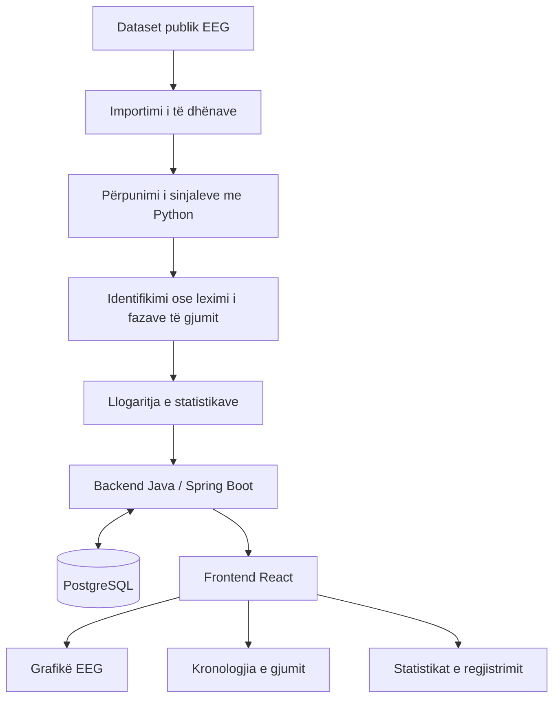
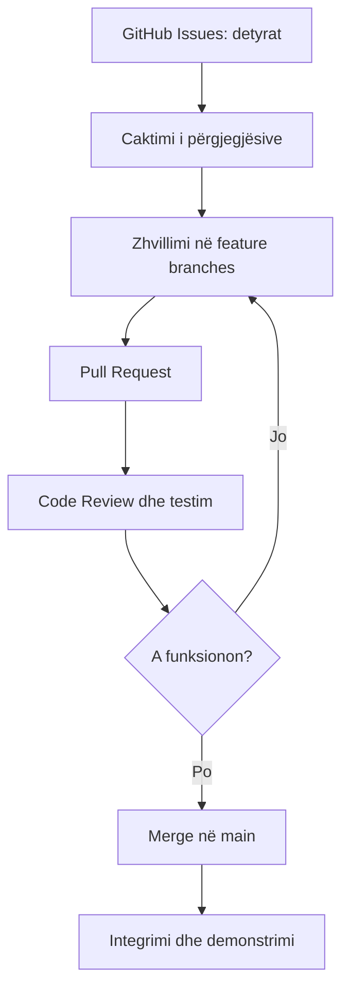

# DREAMSTATE-Inside-the-Sleeping-Brain-Where-Neuroscience-Meets-Software-Engineering
A platform for exploring and visualizing brain activity during sleep using EEG data

# DREAMSTATE — Brenda trurit që fle
### Aty ku neurologjia takohet me inxhinierinë e softuerit

*Çfarë ndodh brenda trurit tonë kur mbyllim sytë dhe bota e jashtme hesht?*

Gjumi është një proces biologjik kompleks, gjatë të cilit truri vazhdon të jetë aktiv. Aktiviteti i tij ndryshon nga një fazë e gjumit në tjetrën, duke krijuar modele elektrike që mund të regjistrohen dhe të studiohen.

**DREAMSTATE** është një platformë kërkimore dhe edukative që synon të sjellë këto sinjale më pranë nesh përmes teknologjisë. Duke përdorur të dhëna EEG nga regjistrime të gjumit, platforma do t'i përpunojë, analizojë dhe paraqesë ato në mënyrë vizuale e të kuptueshme.

Projekti nuk synon të lexojë ëndrrat apo të diagnostikojë çrregullime. Ai synon të eksplorojë aktivitetin e trurit gjatë gjumit dhe të tregojë se si të dhënat shkencore mund të shndërrohen në informacion të kuptueshëm.

---

## 1. Ku takohen neurologjia dhe inxhinieria e softuerit?

DREAMSTATE lind në pikën ku dy fusha të ndryshme plotësojnë njëra-tjetrën: **neurologjia na ndihmon të kuptojmë fenomenin biologjik, ndërsa inxhinieria e softuerit na jep mjetet për ta analizuar dhe paraqitur atë.**

### 🧠 Neurologjia — kuptimi i trurit

Neurologjia dhe neuroshkenca studiojnë funksionimin e sistemit nervor dhe aktivitetin e trurit. Në këtë projekt, fokusi është te gjumi dhe ndryshimet e aktivitetit cerebral gjatë fazave të tij.

Përmes EEG-së (*Electroencephalography*), aktiviteti elektrik i trurit regjistrohet si sinjal që ndryshon me kalimin e kohës. Këto regjistrime mund të ndihmojnë studiuesit të dallojnë faza të ndryshme të gjumit, si zgjimi, gjumi NREM dhe gjumi REM.

### 💻 Inxhinieria e softuerit — shndërrimi i të dhënave në informacion

Inxhinieria e softuerit siguron strukturën që e bën këtë informacion të përdorshëm. Ajo përfshin ndërtimin e aplikacionit, menaxhimin e të dhënave, zhvillimin e API-ve, përpunimin e sinjaleve, vizualizimin dhe testimin e sistemit.

Në vend që të shohim vetëm një skedar me mijëra vlera numerike, përdoruesi do të mund të eksplorojë sinjalin EEG përmes grafikëve, të shohë ndarjen e fazave të gjumit dhe të kuptojë statistikat kryesore të një regjistrimi.

### 🔗 Pika e takimit — të dhënat

Lidhja mes dy fushave realizohet përmes të dhënave.

Neurologjia përcakton kuptimin shkencor të sinjaleve dhe fazave të gjumit. Programimi mundëson leximin dhe përpunimin e regjistrimeve, ruajtjen e rezultateve dhe paraqitjen e tyre në një ndërfaqe interaktive.

Kështu, **DREAMSTATE ndërthur njohuritë mbi trurin me algoritmet, bazat e të dhënave dhe vizualizimin**, duke krijuar një urë mes kërkimit shkencor dhe teknologjisë.

---

## 2. Objektivat e projektit

- Importimi dhe eksplorimi i të dhënave EEG nga një dataset publik kërkimor.
- Përpunimi i regjistrimeve dhe paraqitja e sinjaleve në grafikë.
- Vizualizimi i fazave të gjumit sipas anotimeve të disponueshme.
- Llogaritja e statistikave për kohëzgjatjen dhe përqindjen e fazave të gjumit.
- Ruajtja dhe organizimi i të dhënave përmes një baze të dhënash.
- Krijimi i një ndërfaqeje interaktive dhe të kuptueshme.
- Si zgjerim i mundshëm, eksplorimi i klasifikimit automatik të fazave të gjumit me Machine Learning.

**Dataset për t'u shqyrtuar:** [Sleep-EDF Expanded — PhysioNet](https://physionet.org/content/sleep-edfx/)

Përpara integrimit, do të verifikojmë formatin e skedarëve, anotimet, licencën dhe mënyrën e përshtatjes së të dhënave me projektin.

---

## 3. Si do të funksionojë sistemi?



Rrjedha paraqet arkitekturën e propozuar. Në versionin fillestar mund të përdorim anotimet ekzistuese të dataset-it; klasifikimi automatik do të shtohet vetëm nëse kemi kohë dhe të dhëna të përshtatshme.

---

## 4. Teknologjitë

| Teknologjia | Roli në projekt |
|---|---|
| Java + Spring Boot | Backend, logjika e aplikacionit dhe API-të |
| React | Ndërfaqja grafike dhe ndërveprimi me përdoruesin |
| Python | Përpunimi dhe analiza e sinjaleve EEG |
| PostgreSQL | Ruajtja dhe organizimi i të dhënave |
| Git + GitHub | Versionimi, bashkëpunimi dhe menaxhimi i detyrave |
| JUnit, pytest, Postman | Testimi i komponentëve dhe API-ve |

---

## 5. Ndarja e punës në grup

### Anëtari 1 — Team Leader & Backend
- Organizimi i punës dhe ndjekja e afateve.
- Zhvillimi i backend-it me Java dhe Spring Boot.
- Krijimi dhe integrimi i API-ve.
- Koordinimi i punës mes pjesëtarëve.

### Anëtari 2 — Frontend Developer
- Zhvillimi i ndërfaqes me React.
- Ndërtimi i dashboard-it dhe grafikëve.
- Paraqitja e fazave të gjumit dhe statistikave.
- Lidhja e frontend-it me backend-in.

### Anëtari 3 — EEG Data & Python
- Shqyrtimi i dataset-it publik.
- Leximi dhe përpunimi i regjistrimeve EEG.
- Përgatitja e të dhënave dhe llogaritja e statistikave.
- Eksplorimi i Machine Learning si funksionalitet shtesë.

### Anëtari 4 — Database, Testing & Documentation
- Projektimi i skemës së PostgreSQL.
- Testimi i API-ve dhe funksionaliteteve.
- Dokumentimi i sistemit dhe udhëzimeve të instalimit.
- Ndihma në integrim dhe kontrollin e cilësisë.

Ndarja është fillestare. Detyrat mund të përshtaten sipas ecurisë dhe njohurive të secilit anëtar.

---

## 6. Plani i punës — 8 javë

| Java | Faza | Rezultati i synuar |
|---|---|---|
| 1 | Analiza dhe planifikimi | Kërkesat, objektivat dhe detyrat |
| 2 | Projektimi | Arkitektura, diagramet dhe skema e databazës |
| 3 | Konfigurimi | Struktura e projektit dhe mjedisi i zhvillimit |
| 4 | Versioni bazë | Frontend, backend dhe databaza funksionale |
| 5 | Analiza e EEG-së | Importimi, përpunimi dhe vizualizimi fillestar |
| 6 | Integrimi | Komponentët komunikojnë me njëri-tjetrin |
| 7 | Testimi | Identifikimi dhe korrigjimi i gabimeve |
| 8 | Finalizimi | Dokumentacioni dhe prezantimi |

---

## 7. Bashkëpunimi në GitHub



Do të përdorim GitHub Issues për detyrat, branches të veçanta për zhvillimin e funksionaliteteve dhe Pull Requests për të kontrolluar ndryshimet përpara integrimit.

Statuset e detyrave:
- **Për t'u bërë**
- **Në proces**
- **Në shqyrtim**
- **Përfunduar**

---

## 8. Struktura e propozuar

```text
DREAMSTATE/
├── frontend/
├── backend/
├── analysis/
├── database/
├── docs/
├── tests/
└── README.md
```

Struktura do të përshtatet sipas nevojave të implementimit.

---

## 9. Rezultati përfundimtar

Në fund synojmë të kemi një aplikacion funksional që lejon përdoruesin të zgjedhë një regjistrim, të eksplorojë sinjalin EEG, të shohë fazat e gjumit dhe të analizojë statistikat bazë.

Projekti do të demonstrojë se si njohuritë e neurologjisë mund të kombinohen me programimin, analizën e të dhënave dhe projektimin e sistemeve për të krijuar një mjet edukativ me vlerë shkencore.

Funksionalitetet do të zhvillohen gradualisht. Prioriteti është një version bazë i besueshëm dhe i testuar; Machine Learning do të jetë zgjerim i mundshëm, jo kusht për përfundimin e projektit.

---

*DREAMSTATE — Sepse edhe kur trupi pushon, truri vazhdon të tregojë historinë e tij përmes sinjaleve.*
