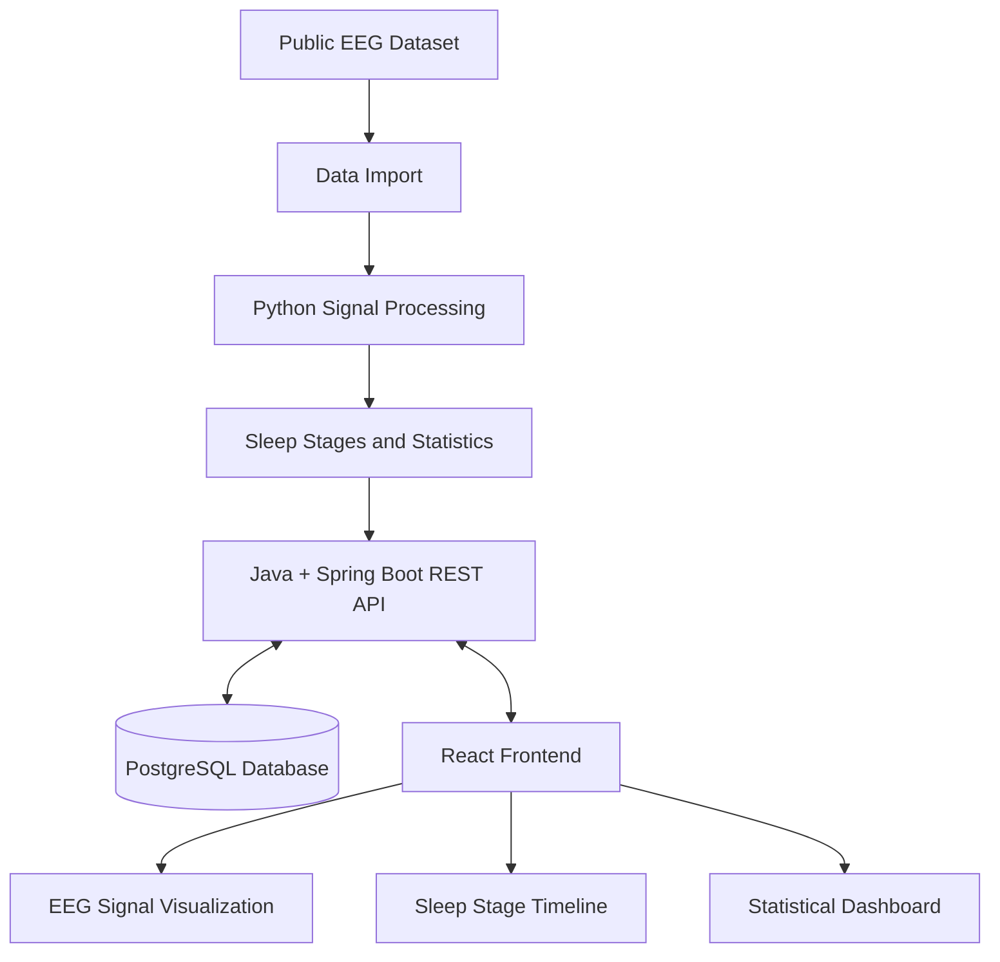
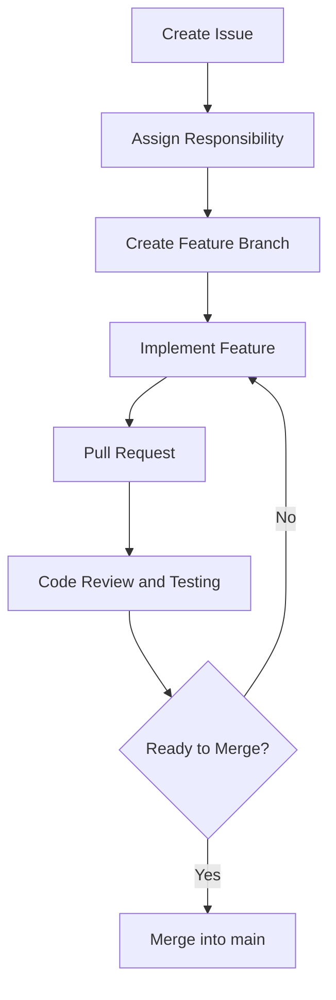

# DREAMSTATE — Inside the Sleeping Brain
### Where Neuroscience Meets Software Engineering

*Çfarë ndodh brenda nesh kur mbyllim sytë dhe bota hesht?*

Gjumi është një proces biologjik kompleks gjatë të cilit truri vazhdon të jetë aktiv. Aktiviteti elektrik i tij ndryshon gjatë fazave të ndryshme të gjumit, duke krijuar sinjale që mund të regjistrohen, analizohen dhe studiohen.

**DREAMSTATE** është një platformë kërkimore dhe edukative që synon të eksplorojë aktivitetin e trurit gjatë gjumit përmes të dhënave EEG (*Electroencephalography*), përpunimit kompjuterik dhe vizualizimit interaktiv.

Projekti synon t'i shndërrojë regjistrimet shkencore në informacion të kuptueshëm, duke u mundësuar përdoruesve të eksplorojnë sinjalet EEG, të shohin fazat e gjumit dhe të analizojnë statistikat kryesore të një regjistrimi.

DREAMSTATE nuk synon të lexojë ëndrrat apo të diagnostikojë sëmundje. Ai synon të krijojë një urë midis kërkimit shkencor dhe teknologjisë, duke treguar se si të dhënat mbi trurin mund të bëhen të eksplorueshme përmes një aplikacioni softuerik.

---

## 1. The Idea — Ideja e projektit

DREAMSTATE bazohet në idenë se aktiviteti i trurit gjatë gjumit mund të eksplorohet përmes të dhënave dhe mjeteve kompjuterike.

Përmes EEG-së, aktiviteti elektrik i trurit regjistrohet si sinjal që ndryshon me kalimin e kohës. Këto regjistrime mund të shoqërohen me anotime që identifikojnë faza të ndryshme të gjumit, si zgjimi, NREM dhe REM.

Platforma do t'i paraqesë këto të dhëna në mënyrë vizuale, duke e bërë më të lehtë eksplorimin e sinjaleve dhe kuptimin e strukturës së një regjistrimi gjumi.

### Objektivat kryesore

- Importimi dhe eksplorimi i regjistrimeve EEG.
- Përpunimi dhe paraqitja vizuale e sinjaleve.
- Shfaqja e fazave të gjumit sipas anotimeve të disponueshme.
- Llogaritja e kohëzgjatjes dhe përqindjes së fazave të gjumit.
- Organizimi dhe ruajtja e të dhënave.
- Ndërtimi i një ndërfaqeje interaktive.
- Eksplorimi i klasifikimit automatik me Machine Learning si funksionalitet shtesë.

---

## 2. Where Neuroscience Meets Software Engineering

### 🧠 Neuroscience — Kuptimi i trurit

Neuroshkenca studion sistemin nervor dhe mënyrën se si funksionon truri. Në këtë projekt, fokusi është te aktiviteti cerebral gjatë gjumit.

EEG-ja është një metodë që regjistron aktivitetin elektrik të trurit përmes elektrodave të vendosura në skalp. Sinjalet e regjistruara mund të analizohen për të studiuar ndryshimet që ndodhin gjatë fazave të gjumit.

Kjo fushë i jep projektit bazën shkencore: çfarë përfaqësojnë të dhënat dhe pse është e rëndësishme të studiohen.

### 💻 Software Engineering — Ndërtimi i sistemit

Inxhinieria e softuerit ofron mjetet për t'i kthyer të dhënat shkencore në një platformë funksionale.

Përmes programimit mund të lexojmë skedarët EEG, të përpunojmë sinjalet, të ruajmë rezultatet në një databazë dhe t'i paraqesim ato përmes grafikëve dhe elementeve interaktive.

Kjo fushë i jep projektit strukturën teknike: si përpunohen të dhënat, si komunikojnë komponentët dhe si ndërtohet një sistem i qëndrueshëm.

### 🔗 The Intersection — Pika e takimit

Pika e takimit mes neuroshkencës dhe inxhinierisë së softuerit është **përpunimi, analiza dhe vizualizimi i të dhënave EEG**.

Neuroshkenca ndihmon në interpretimin e aktivitetit të trurit, ndërsa teknologjia mundëson përpunimin sistematik të regjistrimeve dhe paraqitjen e rezultateve.

DREAMSTATE i bashkon këto dy fusha përmes analizës së të dhënave, algoritmeve, bazave të të dhënave dhe zhvillimit të aplikacioneve.

---

## 3. System Architecture

Arkitektura e propozuar përshkruan rrugën nga regjistrimi shkencor deri te paraqitja e rezultateve në aplikacion.



### Rrjedha e të dhënave

1. **Data Import:** përzgjidhen dhe importohen regjistrimet EEG.
2. **Signal Processing:** të dhënat lexohen dhe përpunohen me Python.
3. **Sleep Stages and Statistics:** përdoren anotimet e disponueshme për të paraqitur fazat dhe për të llogaritur statistikat.
4. **Backend API:** Java dhe Spring Boot menaxhojnë logjikën e aplikacionit dhe ofrojnë të dhënat për frontend-in.
5. **Database:** PostgreSQL ruan informacionin që kërkon aplikacioni.
6. **Frontend:** React paraqet sinjalet, fazat dhe statistikat në një ndërfaqe interaktive.

Arkitektura mund të përshtatet pasi të shqyrtojmë formatin konkret të dataset-it.

---

## 4. Technology Stack

DREAMSTATE do të ndërtohet duke përdorur teknologji që bashkëpunojnë për të krijuar një platformë të plotë, nga përpunimi i sinjaleve EEG deri te vizualizimi i tyre.

| Teknologjia | Shtresa | Roli në projekt |
|---|---|---|
| **React** | Frontend | Ndërtimi i ndërfaqes, dashboard-it dhe elementeve interaktive |
| **Java** | Backend | Implementimi i logjikës kryesore të aplikacionit |
| **Spring Boot** | Backend Framework | Krijimi i REST API-ve dhe komunikimi mes komponentëve |
| **Python** | Data Processing | Leximi, përpunimi dhe analiza e sinjaleve EEG |
| **PostgreSQL** | Database | Ruajtja dhe organizimi i të dhënave dhe rezultateve |
| **Git** | Version Control | Ndjekja e ndryshimeve në kod |
| **GitHub** | Collaboration | Bashkëpunimi, menaxhimi i detyrave dhe integrimi i kodit |
| **Postman** | API Testing | Testimi i kërkesave dhe përgjigjeve të backend-it |
| **JUnit** | Backend Testing | Testimi automatik i komponentëve Java |
| **pytest** | Python Testing | Testimi i skripteve të analizës së të dhënave |

### Si bashkëpunojnë teknologjitë?

- **Python** përpunon të dhënat shkencore dhe përgatit rezultatet.
- **Java + Spring Boot** menaxhojnë logjikën e aplikacionit dhe ofrojnë REST API.
- **PostgreSQL** ruan informacionin e nevojshëm për aplikacionin.
- **React** i paraqet rezultatet në një ndërfaqe vizuale.
- **Git + GitHub** mundësojnë zhvillimin në grup, kontrollin e versioneve dhe shqyrtimin e ndryshimeve.
- **JUnit, pytest dhe Postman** ndihmojnë në verifikimin e funksionimit të sistemit.

Teknologjitë do të integrohen gradualisht, duke filluar nga funksionalitetet bazë.

---

## 5. Core Features

### Funksionalitetet bazë — MVP

Versioni fillestar do të përqendrohet te funksionalitetet që mund të ndërtohen, testohen dhe demonstrohen brenda afatit të projektit.

- **EEG Data Explorer:** zgjedhja dhe eksplorimi i regjistrimeve EEG.
- **Signal Visualization:** paraqitja grafike e sinjalit.
- **Sleep Stage Timeline:** vizualizimi i fazave të gjumit sipas anotimeve ekzistuese.
- **Sleep Statistics:** llogaritja e kohëzgjatjes dhe përqindjes së fazave.
- **Interactive Dashboard:** paraqitja e informacionit kryesor në një ndërfaqe të vetme.

### Funksionalitete shtesë — Future Enhancements

Nëse versioni bazë përfundon në kohë, projekti mund të zgjerohet me:

- Klasifikimin automatik të fazave të gjumit përmes Machine Learning.
- Krahasimin e regjistrimeve të ndryshme.
- Filtrimin dhe eksplorimin më të avancuar të sinjaleve.
- Statistika shtesë dhe vizualizime më të detajuara.

Klasifikimi automatik nuk është kusht për përfundimin e versionit bazë.

---

## 6. Dataset and Scientific Data

Për analizën e sinjaleve do të shqyrtojmë një dataset publik kërkimor që përmban regjistrime EEG gjatë gjumit, si Sleep-EDF Expanded.

Një dataset i tillë mund të ofrojë sinjale dhe anotime të fazave të gjumit, duke na lejuar të zhvillojmë dhe testojmë funksionalitetet e platformës.

Përpara integrimit do të verifikojmë:

- Formatet dhe strukturën e skedarëve.
- Disponueshmërinë e anotimeve të fazave të gjumit.
- Përputhshmërinë me mjetet e përpunimit në Python.
- Kushtet e përdorimit të të dhënave.
- Madhësinë e dataset-it dhe burimet kompjuterike të nevojshme.

Për prototipin fillestar do të përdorim një numër të kufizuar regjistrimesh. Kjo do ta bëjë zhvillimin dhe testimin më të menaxhueshëm.

---

## 7. Team Structure and Responsibilities

Projekti do të zhvillohet nga një ekip me katër anëtarë. Ndarja fillestare e përgjegjësive do të jetë si më poshtë.

### Member 1 — Team Leader & Backend Developer

- Organizimi i punës dhe ndjekja e afateve.
- Zhvillimi i backend-it me Java dhe Spring Boot.
- Krijimi i REST API-ve.
- Koordinimi dhe integrimi i komponentëve.
- Shqyrtimi i progresit dhe shpërndarja e detyrave.

### Member 2 — Frontend Developer

- Zhvillimi i ndërfaqes me React.
- Ndërtimi i dashboard-it.
- Vizualizimi i sinjaleve EEG dhe fazave të gjumit.
- Lidhja e frontend-it me backend-in.
- Përmirësimi i përvojës së përdoruesit.

### Member 3 — EEG Data & Python Developer

- Shqyrtimi dhe përzgjedhja e regjistrimeve.
- Leximi dhe përpunimi i sinjaleve EEG.
- Përgatitja e të dhënave për analizë.
- Llogaritja e statistikave.
- Eksplorimi i Machine Learning si zgjerim i mundshëm.

### Member 4 — Database, Testing & Documentation

- Projektimi i skemës së PostgreSQL.
- Testimi i API-ve dhe funksionaliteteve.
- Dokumentimi i arkitekturës dhe instalimit.
- Kontrolli i cilësisë dhe ndihma në integrim.

Kjo ndarje është orientuese. Anëtarët do të bashkëpunojnë gjatë zhvillimit dhe përgjegjësitë mund të përshtaten sipas nevojave të projektit.

---

## 8. Development Roadmap

Plani fillestar parashikon tetë javë pune.

| Java | Faza | Rezultati i synuar |
|---|---|---|
| **1** | Analiza dhe planifikimi | Kërkesat, objektivat dhe ndarja e detyrave |
| **2** | Projektimi i sistemit | Arkitektura, diagramet dhe skema e databazës |
| **3** | Konfigurimi | Struktura e repository-t dhe mjedisi i zhvillimit |
| **4** | Versioni bazë | Frontend, backend dhe databaza fillestare |
| **5** | Analiza e EEG-së | Importimi, përpunimi dhe vizualizimi fillestar |
| **6** | Integrimi | Komunikimi mes komponentëve |
| **7** | Testimi | Identifikimi dhe korrigjimi i gabimeve |
| **8** | Finalizimi | Dokumentacioni dhe prezantimi |

Afatet mund të përshtaten sipas ecurisë së grupit dhe kompleksitetit të të dhënave.

---

## 9. GitHub Workflow

Për të organizuar zhvillimin, do të përdorim GitHub si hapësirë të përbashkët për kodin dhe dokumentacionin.

### Procesi i punës



### Rregullat e bashkëpunimit

- Çdo detyrë e rëndësishme do të regjistrohet si **GitHub Issue**.
- Çdo anëtar do të zhvillojë funksionalitetet në një branch të veçantë.
- Ndryshimet do të shqyrtohen përmes **Pull Requests**.
- Branch-i `main` do të mbahet sa më i qëndrueshëm.
- Funksionalitetet do të testohen përpara integrimit.

### Statuset e detyrave

1. Për t'u bërë
2. Në proces
3. Në shqyrtim
4. Përfunduar

---

## 10. Project Structure

Struktura fillestare e repository-t do të jetë:

```text
DREAMSTATE/
│
├── frontend/
│   └── React application
│
├── backend/
│   └── Spring Boot application
│
├── analysis/
│   └── Python EEG processing
│
├── database/
│   └── Database schema and scripts
│
├── docs/
│   └── Diagrams and project documentation
│
├── tests/
│   └── Testing resources
│
└── README.md
```

Çdo direktori do të përmbajë komponentët përkatës. Struktura mund të përshtatet gjatë zhvillimit, pasi të përcaktohen më mirë kërkesat teknike.

---

## 11. Testing and Quality Assurance

Testimi do të jetë pjesë e procesit të zhvillimit, jo vetëm faza e fundit.

Do të synojmë të verifikojmë:

- Funksionimin e endpoint-eve të backend-it.
- Saktësinë e llogaritjeve statistikore.
- Leximin dhe përpunimin e regjistrimeve EEG.
- Komunikimin ndërmjet frontend-it dhe backend-it.
- Ruajtjen dhe marrjen e të dhënave nga databaza.
- Paraqitjen e saktë të rezultateve në ndërfaqe.

Mjetet e testimit do të zgjidhen sipas komponentit: JUnit për Java, pytest për Python dhe Postman për testimin e API-ve.

---

## 12. Expected Deliverables

Në fund të projektit synojmë të dorëzojmë:

- Një aplikacion funksional për eksplorimin e të dhënave EEG.
- Një frontend interaktiv.
- Një backend me REST API.
- Një bazë të dhënash të organizuar.
- Funksionalitete për vizualizimin e sinjaleve dhe fazave të gjumit.
- Statistika bazë për regjistrimet e përzgjedhura.
- Teste për komponentët kryesorë.
- Dokumentacion teknik dhe udhëzime për ekzekutimin e projektit.
- Një prezantim që shpjegon lidhjen mes neuroshkencës dhe inxhinierisë së softuerit.

---

## 13. Scope and Limitations

DREAMSTATE është projekt edukativ dhe kërkimor.

Rezultatet do të varen nga cilësia e regjistrimeve, formati i skedarëve dhe anotimet e disponueshme. Fazat e gjumit do të paraqiten sipas anotimeve ekzistuese ose, nëse implementohet një model, sipas parashikimeve të tij të vlerësuara.

Platforma nuk është pajisje mjekësore, nuk zëvendëson vlerësimin nga profesionistët shëndetësorë dhe nuk synon të diagnostikojë çrregullime të gjumit.

---

## 14. Final Vision

DREAMSTATE synon të tregojë se si një fenomen biologjik mund të eksplorohet përmes mjeteve të inxhinierisë së softuerit.

Duke kombinuar sinjalet EEG, përpunimin e të dhënave, bazat e të dhënave dhe vizualizimin interaktiv, projekti do të krijojë një pikë takimi mes neuroshkencës dhe teknologjisë.

Qëllimi nuk është vetëm të ndërtojmë një aplikacion, por të kuptojmë se si njohuritë shkencore mund të shndërrohen në sisteme softuerike të dobishme, të organizuara dhe të testuara.

*DREAMSTATE — Even when the body rests, the brain continues to tell its story through signals.*
